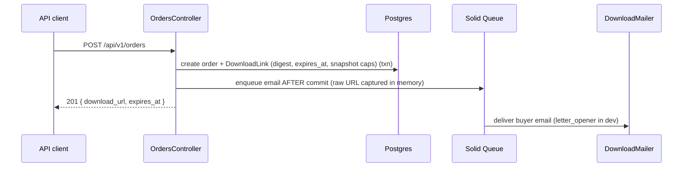
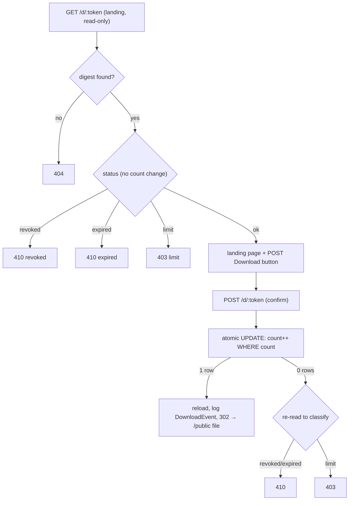

# Download System — Take-Home Assignment

My submission for an engineering take-home: build a simplified version of Download System’s digital product download flow.

## Background

Download System sells digital products. When a buyer completes a purchase, they receive a time-limited download link. The assignment is to build a Rails app that covers that flow end to end.

## Assignment Requirements


| Area               | Description                                                                                                                     |
| ------------------ | ------------------------------------------------------------------------------------------------------------------------------- |
| **Products**       | Merchants create products with a name, file (can be faked/stubbed), and download settings (expiry hours, max download count).   |
| **Orders & links** | A JSON API accepts an order (product + buyer email), creates a unique expiring download link, and queues an email to the buyer. |
| **Downloads**      | The link works until it expires or hits the download limit, then returns an appropriate error.                                  |
| **Dashboard**      | A simple frontend showing products, recent orders, and download activity (Svelte/TypeScript preferred).                         |


## Tech Stack

- **Ruby** 3.4.9
- **Rails** 8.1
- **PostgreSQL** — primary database
- **Solid Queue** — background jobs (email delivery in production)
- **Letter Opener** — preview emails in the browser during development
- **Slim** — view templates for download pages and dashboard shell
- **vite_rails** + **Svelte 5** + **TypeScript** — dashboard frontend only (`app/frontend/`)

## Prerequisites

- Ruby 3.4.9 (see `.ruby-version`)
- Bundler
- PostgreSQL 9.5+
- **Node 20** (see `.node-version`) — required to build the dashboard (`npm ci && npm run build`). The Rails backend and `bin/rails test` run without Node.

## Setup

PostgreSQL must be running locally. Rails creates `download_system_development` and `download_system_test` by default (see `config/database.yml`).

```bash
git clone <repo-url>
cd download_system
bundle install
bin/rails db:prepare   # creates the DB, runs migrations, runs seeds
```

Or run the all-in-one script, which installs gems, prepares the DB, and starts the dev server:

```bash
bin/setup              # add --reset to drop+reseed; --skip-server to stop short of starting
```

## Running the App

```bash
bin/dev
```

The app runs at [http://localhost:3000](http://localhost:3000). Health check: [http://localhost:3000/up](http://localhost:3000/up).

## Seed data (demo URLs)

`bin/rails db:seed` (idempotent) creates four download links covering every state in the error matrix. Paste each URL into a browser to see the matching response:

| State    | URL                                                      | Expected response                |
| -------- | -------------------------------------------------------- | -------------------------------- |
| Normal   | `http://localhost:3000/d/dev-active-link-token`          | 200, landing page + `Download` button |
| Expired  | `http://localhost:3000/d/dev-expired-link-token`         | 410, "Download link expired"     |
| Maxed    | `http://localhost:3000/d/dev-maxed-link-token`           | 403, "Download limit reached"    |
| Revoked  | `http://localhost:3000/d/dev-revoked-link-token`         | 410, "Download link revoked"     |

Expected responses above are the HTML page headings (`h1`). JSON clients get the longer messages in [Error → HTTP status](#error--http-status) below.

Clicking the `Download` button on the normal link redirects to the real placeholder at `public/downloads/sample.pdf`. The DB only stores `SHA256(token)`; the raw tokens above live solely in `db/seeds.rb` and the URLs.

## Sample request

Create an order via the JSON API and capture the issued download URL:

```bash
curl -i -X POST http://localhost:3000/api/v1/orders \
  -H "Content-Type: application/json" \
  -d '{"order": {"product_id": 1, "buyer_email": "buyer@example.com"}}'
```

Successful response (`201 Created`):

```json
{
  "order_id": 7,
  "download_url": "http://localhost:3000/d/<raw-token>",
  "expires_at": "2026-06-19T20:00:00.000Z",
  "max_downloads": 3
}
```

The same URL is also emailed to the buyer (via Letter Opener in development). Flat params (`{"product_id": 1, "buyer_email": "…"}`) also work. Missing product -> `404`; invalid email or missing fields -> `422`; all errors follow the `{ "error": { "code", "message" } }` envelope.

Create a product via the API:

```bash
curl -i -X POST http://localhost:3000/api/v1/products \
  -H "Content-Type: application/json" \
  -d '{"product": {"name": "New Ebook", "file_name": "new.pdf", "expiry_hours": 48, "max_downloads": 5}}'
```

### Background jobs

In production, emails are processed via Solid Queue. In development, Rails uses the in-process `:async` adapter by default. To run Solid Queue locally:

```bash
bin/jobs
```

### Email in development

Outgoing mail opens in the browser via [Letter Opener](https://github.com/ryanb/letter_opener) instead of being sent for real.

## Tests

```bash
bin/rails test
bin/rails test:system
```

Dashboard frontend (optional, needs Node 20):

```bash
npm ci && npm run build && npm run check
```

CI runs Brakeman, Bundler Audit, RuboCop, JavaScript audit/build, and the test suite on push/PR to `main`.

The download-limit concurrency test (`test/controllers/downloads_concurrency_test.rb`)
fires 10 parallel `POST /d/:token` requests against a link with `max_downloads: 5`. It
disables transactional fixtures so threads can observe each other's commits, and raises
the Active Record connection pool to at least 15 for the test run. If you see pool
timeouts running that file alone, set `RAILS_MAX_THREADS=15` (or higher) before
`bin/rails test`.

## Architecture

### Order → link → email



### Two-step download (prefetch-safe)

`GET /d/:token` renders a read-only landing page that changes no state, so email
security scanners and link prefetchers (which only issue GET) can't consume a
download. Only the buyer's explicit `POST /d/:token` counts. The HTML form
includes a CSRF token; JSON POSTs skip verification for programmatic clients.



Download-limit enforcement is a single atomic conditional `UPDATE` (no
read-then-write, no row lock), so the cap can never be exceeded under concurrency.
The raw 256-bit token lives only in the emailed URL; the database stores only
`SHA256(token)` and looks up by that indexed digest.

### Error → HTTP status

| Condition                       | Status | Message                                      |
| ------------------------------- | ------ | -------------------------------------------- |
| Unknown token                   | 404    | Link not found                               |
| Expired                         | 410    | This download link has expired               |
| Revoked                         | 410    | This download link has been revoked          |
| Limit reached                   | 403    | This link has reached its download limit     |
| Product missing (order create)  | 404    | —                                            |
| Validation (e.g. bad email)     | 422    | —                                            |

Browsers get friendly HTML pages (short `h1` headings on error templates); API clients get JSON via `respond_to` with the messages in the table above.

## Revoking a link

Revocation blocks `/d/:token` (GET and POST) but does **not** remove the public placeholder at `/downloads/sample.pdf`. In production, files would be served via presigned URLs instead.

```bash
# By numeric database ID
bin/rails 'download_links:revoke[42]'

# By raw token from the buyer URL (zsh requires quotes around the task argument)
bin/rails 'download_links:revoke[dev-active-link-token]'
```

Re-running revoke on an already-revoked link prints an "already revoked" message without changing `revoked_at`.

## Assumptions, tradeoffs, and manual verification

### Assumptions

- **Bearer URL = access.** Anyone with `/d/:token` can download until expiry, cap, or revoke. There is no per-buyer auth.
- **Product settings are snapshotted** onto each `DownloadLink` at order time (`expires_at`, `max_downloads`). Changing a product later does not retroactively alter issued links.
- **Placeholder file delivery.** Successful downloads redirect to a static `public/downloads/sample.pdf`, not per-product bytes. Production would use presigned object-storage URLs.
- **Configured host for issued URLs.** `download_url` is built from `action_mailer.default_url_options`, not the request `Host` header.
- **Seeds are idempotent for rows, not for usage.** Re-running `db:seed` does not reset `download_count` on an already-maxed demo link; use `bin/rails db:prepare` or reset the link before re-walking the happy path.

### Tradeoffs (intentional)

| Area | Choice | Cost |
|------|--------|------|
| Download enforcement | Single conditional `UPDATE` (no row lock) | Correct under concurrency; `update_all` bypasses AR callbacks |
| Prefetch safety | GET landing is read-only; POST confirms | Extra click for buyers; stops scanners burning the cap |
| Audit trail | `DownloadEvent` after increment; errors logged, not rolled back | Count can exceed event rows if audit insert fails |
| Email | `deliver_later` after commit | Order can exist without delivered mail if the queue dies |
| API surface | Open `POST /api/v1/orders`, no idempotency | Retries create duplicate orders/links |
| Revocation | `revoked_at` timestamp only | In-flight POST may win if UPDATE runs before revoke is visible (TOCTOU) |
| Token pages | `download` layout, no JavaScript | Dashboard needs a separate Vite build step |
| Dashboard feeds | Orders/events capped at 50/100 rows | All products listed; pagination deferred |

### What was manually checked

Before submission, these were run against a local `bin/dev` server with Postgres up:

- `bin/rails test` — full suite (includes concurrency cap, host-header, feed caps, and event-drift tests)
- `GET /up` → 200
- Seed error matrix: `/d/dev-expired-link-token` → 410, `/d/dev-maxed-link-token` → 403, `/d/dev-revoked-link-token` → 410, `/d/bogus` → 404
- `POST /api/v1/orders` → 201 with `download_url`; missing product → 404; invalid email → 422
- `GET /d/dev-active-link-token` after resetting `download_count` → 200, no `<script>` tags; `POST` → 302 to `/downloads/sample.pdf`
- `public/downloads/sample.pdf` present on disk
- `download_links:revoke` idempotent message on already-revoked seed link

See [docs/MANUAL_QA.md](docs/MANUAL_QA.md) for the step-by-step manual checklist.

## Known Limitations

- **Bearer-token model** — Anyone with the URL can download. The two-step landing page stops email scanners from burning the limit, but it does not prevent link sharing.
- **No product-create UI** — Products are created via `POST /api/v1/products`, seeds, or console; the dashboard is read-only.
- **Open order API** — `POST /api/v1/orders` is unauthenticated. A bad actor could email-bomb arbitrary addresses; production would add `Rack::Attack` throttling.
- **No idempotency** — Retrying a failed order request creates duplicate orders and links. Production would accept an `Idempotency-Key` header and deduplicate within a TTL window.
- **Email delivery gap** — The order transaction commits before `deliver_later` runs. If the job queue fails after commit, the buyer gets no email even though the order exists; an outbox table or recoverable "resend link" flow would close this gap.
- **Revoke TOCTOU** — An in-flight `POST /d/:token` may succeed if the atomic UPDATE runs before `revoked_at` is visible to that connection.
- **Revoke audit trail** — `revoke!` stamps `revoked_at` only; there is no `revoked_by` or reason field. Production would log to an audit table.
- **Public placeholder bytes** — Revocation blocks the token route, not direct access to `public/downloads/sample.pdf`. Production uses short-lived presigned S3/GCS URLs instead of static public files.
- **Count vs. event drift** — `download_count` on the link is canonical. If a `DownloadEvent` insert fails after the atomic increment, the buyer still receives the file (logged error, redirect proceeds).
- **Token in logs** — Request logs include the raw token in `/d/:token` paths. Production would scrub tokens in the log formatter.
- **Token collision** — Retries up to 3 times on `RecordNotUnique` when generating token digests.
- **Dashboard pagination** — API feeds return the 50 most recent orders and 100 most recent download events; all products are listed uncapped.

## Production Considerations

- **Large files** — Never proxy file bytes through Rails. Serve via presigned S3/GCS URLs or `X-Sendfile` against object storage.
- **Email** — Configure SES/SMTP with retries and idempotent sends. Pair `deliver_later` with an outbox or dead-letter queue so failed deliveries are recoverable.
- **Rate limiting** — Add `Rack::Attack` on `POST /api/v1/orders` (per-IP and per-email throttles).
- **Dashboard API auth** — Set `DASHBOARD_TOKEN` in production; dashboard JSON feeds require `Authorization: Bearer <token>` when set (unset in dev/test by default).
- **Host header / URL generation** — Download URLs are built from `action_mailer.default_url_options`, not `request.base_url`. Set the host in `config/environments/production.rb` before deploy (default generator placeholder: `example.com`). Kamal's `proxy.host` in `config/deploy.yml` is the deploy-side counterpart when using SSL.
- **Log scrubbing** — Strip raw tokens from request log lines and error reports.
- **Docker / dashboard build** — The Dockerfile runs `npm ci && npm run build` during the image build stage so the dashboard bundle is included in production images.
- **CSP / Vite HMR** — Content-Security-Policy is not enabled. If added later, dev-only directives are needed for Vite HMR (`@vite/client`).
- **DB `CHECK` on count** — The atomic conditional `UPDATE` is the real download-limit guard; the `download_count <= max_downloads` CHECK is belt-and-suspenders.

See [PROMPTS.md](PROMPTS.md) for design rationale and trade-offs.

## Deploy config

Kamal/Docker files are Rails 8 defaults included for production notes. They are not configured for this take-home; see Production Considerations for what would change before a real deploy.

## Project Structure

```
app/
  controllers/   # API (orders, downloads) and dashboard
  models/        # Product, Order, DownloadLink, DownloadEvent
  jobs/          # Email delivery
  mailers/       # Buyer download link emails
  frontend/      # Svelte/TypeScript dashboard (Vite)
```

