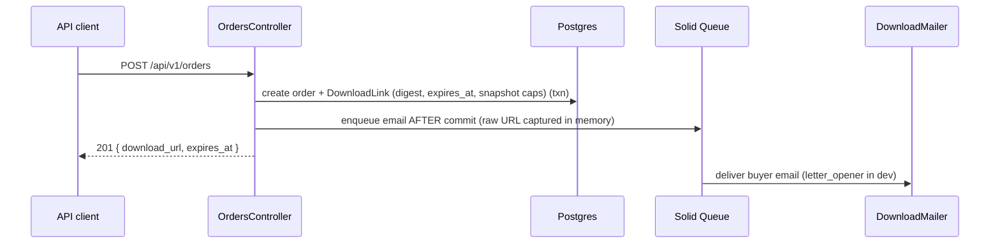
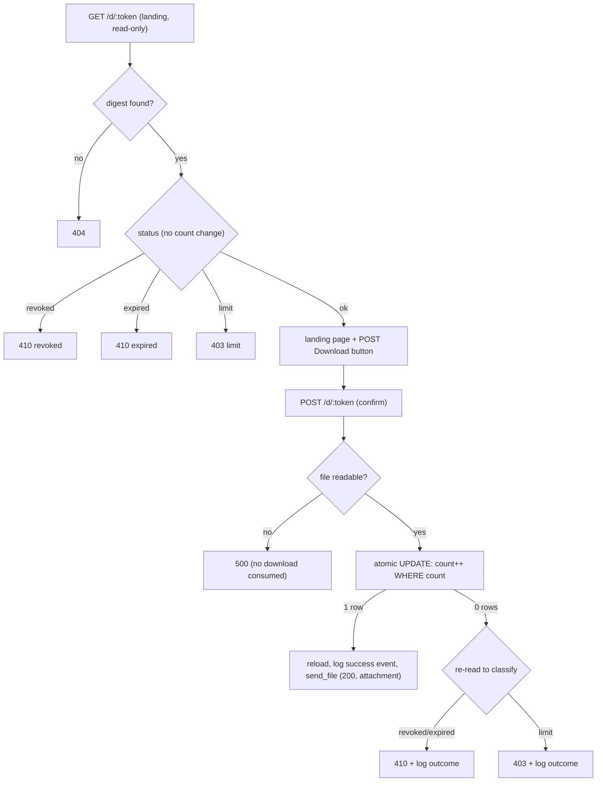

# Download System

Rails app that issues time-limited download links when a buyer purchases a digital product.

## What the app does

A merchant defines products with expiry and download limits. A JSON API accepts orders, creates a unique expiring link, and emails it to the buyer. The buyer opens the link, confirms download, and receives the file. A Svelte dashboard shows products, orders, and download activity.

**Stack:** Ruby 3.4.9, Rails 8.1, PostgreSQL, Solid Queue, Svelte 5 + TypeScript (dashboard only).

## Quick start

Requires Ruby 3.4.9 (`.ruby-version`), PostgreSQL, and Bundler. Node 20 (`.node-version`) is only needed to build the dashboard.

```bash
bundle install && bin/rails db:prepare
bin/dev
```

Open [http://localhost:3000](http://localhost:3000). Health check: [http://localhost:3000/up](http://localhost:3000/up).

Or use `bin/setup` (add `--reset` to drop and reseed; `--skip-server` to stop before starting the server).

## Assignment coverage

| Area | What works |
| ---- | ---------- |
| **Products** | `POST /api/v1/products` creates products with name, file stub, `expiry_hours`, and `max_downloads`. Seeds provide demo products. |
| **Orders & links** | `POST /api/v1/orders` creates an order, issues a unique expiring link, returns `download_url`, and queues buyer email. |
| **Downloads** | `GET /d/:token` shows a landing page; `POST /d/:token` streams the file (token-gated, never a public URL) until expiry, cap, or revoke — each state returns the correct HTTP error. |
| **Dashboard** | Svelte/TypeScript dashboard at `/` lists products, recent orders, and download activity (success + failed-attempt outcomes). |

## Demo data and sample flows

Seeds create four download links covering every error state. Paste each URL into a browser (headings shown are the HTML `h1`; JSON clients get the messages in [Error → HTTP status](#error--http-status)):

| State   | URL                                              | Expected |
| ------- | ------------------------------------------------ | -------- |
| Normal  | `http://localhost:3000/d/dev-active-link-token`  | 200, landing page + `Download` button |
| Expired | `http://localhost:3000/d/dev-expired-link-token` | 410, "Download link expired" |
| Maxed   | `http://localhost:3000/d/dev-maxed-link-token`   | 403, "Download limit reached" |
| Revoked | `http://localhost:3000/d/dev-revoked-link-token` | 410, "Download link revoked" |

Clicking `Download` on the normal link streams the stub file (`storage/product_files/sample.pdf`) through the token-gated controller — the bytes are **not** served from `public/`, so expiry, cap, and revocation actually protect them. The database stores only `SHA256(token)`; raw tokens exist in `db/seeds.rb` and issued URLs.

Create a new order via the API:

```bash
curl -i -X POST http://localhost:3000/api/v1/orders \
  -H "Content-Type: application/json" \
  -d '{"order": {"product_id": 1, "buyer_email": "buyer@example.com"}}'
```

`201 Created` returns `order_id`, `download_url`, `expires_at`, and `max_downloads`. The same URL is emailed to the buyer (Letter Opener opens it in the browser during development). Missing product → `404`; invalid email → `422`. Errors use `{ "error": { "code", "message" } }`.

## Architecture

### Order → link → email



### Two-step download (prefetch-safe)

`GET /d/:token` is read-only — email scanners and prefetchers cannot consume a download. Only `POST /d/:token` increments the count. HTML forms include CSRF; JSON POSTs skip verification for programmatic clients.



The file path is resolved and verified readable **before** the atomic `UPDATE`, so a missing file never consumes one of the buyer's downloads. Download-limit enforcement is a single atomic conditional `UPDATE` (no read-then-write), so the cap cannot be exceeded under concurrency. The raw 256-bit token lives only in the emailed URL; the database stores `SHA256(token)` and looks up by indexed digest. Delivery uses `send_file` — the controller is the only path to the bytes (see [Gated file delivery](#design-decisions-and-tradeoffs)).

### Error → HTTP status

| Condition                      | Status | Message                                  |
| ------------------------------ | ------ | ---------------------------------------- |
| Unknown token                  | 404    | Link not found                           |
| Expired                        | 410    | This download link has expired           |
| Revoked                        | 410    | This download link has been revoked      |
| Limit reached                  | 403    | This link has reached its download limit |
| Product missing (order create) | 404    | —                                        |
| Validation (e.g. bad email)    | 422    | —                                        |

Browsers get friendly HTML pages; API clients get JSON via `respond_to`.

## Tests and verification

```bash
bin/rails test
bin/rails test:system
```

Dashboard frontend (optional, needs Node 20):

```bash
npm ci && npm run build && npm run check
```

CI runs Brakeman, Bundler Audit, RuboCop, JavaScript audit/build, and the full test suite on push/PR to `main`.

**Concurrency test.** `test/controllers/downloads_concurrency_test.rb` fires 10 parallel `POST /d/:token` requests against a link with `max_downloads: 5` and asserts exactly 5 succeed (and that every attempt is audited: 5 `success` + 5 `limit_reached` rows). It disables transactional fixtures and raises the connection pool to at least 15. Known wart: it does that by mutating the global pool with `establish_connection`, which leaks into later tests in the same process; it is isolated (`parallelize(workers: 1)`) and left as-is rather than risking churn. If you see pool timeouts running that file alone, set `RAILS_MAX_THREADS=15` (or higher) before `bin/rails test`.

**Manual smoke checks** (against a running `bin/dev` server):

- `GET /up` → 200
- Seed error matrix: expired/maxed/revoked/bogus tokens → 410/403/410/404
- `POST /api/v1/orders` → 201 with `download_url`; missing product → 404; invalid email → 422
- Active link: `GET` → 200 landing; `POST` → 200 file stream (`Content-Disposition: attachment`)
- `download_links:revoke` prints idempotent message on already-revoked link

Step-by-step checklist: [docs/MANUAL_QA.md](docs/MANUAL_QA.md).

## Design decisions and tradeoffs

**Assumptions**

- **Bearer URL = access.** Anyone with `/d/:token` can download until expiry, cap, or revoke. No per-buyer auth. "Gated" means unauthorized bytes are blocked — not that the token cannot leak (see [Known limitations](#known-limitations-and-production-notes)).
- **Settings snapshotted** onto each `DownloadLink` at order time. Changing a product later does not alter issued links.
- **Gated stub delivery.** Every demo product points at one stub, `storage/product_files/sample.pdf` (outside `public/`). `DownloadDelivery` resolves `File.basename(product.file_name)` under that directory and `send_file`s it; production swaps this for a short-lived presigned URL.
- **Configured host.** `download_url` is built from `action_mailer.default_url_options`, not the request `Host` header.
- **Seeds reset rows, not usage.** Re-running `db:seed` does not reset `download_count` on a maxed demo link; use `bin/rails db:prepare` or reset the link manually.

**Intentional tradeoffs**

| Area | Choice | Cost |
| ---- | ------ | ---- |
| File delivery | Token-gated `send_file` from `storage/product_files/` | Streams through Puma (fine for a stub; production uses presigned URLs for large files) |
| Delivery safety | Resolve + verify file readable **before** the increment | One extra `File.file?`/`readable?` per download |
| No file fallback | Missing file → 500, never serve the wrong bytes | A misconfigured product fails loudly instead of silently shipping `sample.pdf` |
| Download enforcement | Single conditional `UPDATE` | Atomic guard in one statement; `update_all` bypasses AR callbacks |
| Token collision | No retry on `RecordNotUnique` | A ~2^-128 digest collision surfaces as a 500 instead of hiding a real bug behind a retry |
| Prefetch safety | GET landing read-only; POST confirms | Extra click; mitigates GET-only scanners, not POST bots |
| Audit trail | `DownloadEvent` with `outcome`, best-effort after the UPDATE | Count can exceed event rows if audit insert fails; failed attempts logged only for existing links |
| Email | `deliver_later` after commit | Order can exist without delivered mail if queue dies |
| API surface | Open `POST /api/v1/orders`, rate-limited, no idempotency | `Rack::Attack` bounds floods; retries still create duplicate orders/links |
| Revocation | `revoked_at` timestamp only | In-flight POST may win before revoke is visible (TOCTOU) |
| Token pages | `download` layout, no JavaScript | Dashboard needs separate Vite build |
| Dashboard feeds | Orders/events capped at 50/100 rows | All products listed; pagination deferred |

Design rationale and the mid-project realignment: [PROMPTS.md](PROMPTS.md).

## Operational tasks

**Revoke a link** (blocks `/d/:token` GET and POST; the stub file in `storage/product_files/` is shared, so revocation kills the token, not the file):

```bash
bin/rails 'download_links:revoke[42]'                    # by database ID
bin/rails 'download_links:revoke[dev-active-link-token]'  # by raw token (quote for zsh)
```

Re-running revoke on an already-revoked link prints "already revoked" without changing `revoked_at`.

**Background jobs.** Production uses Solid Queue for email. Development defaults to in-process `:async`. To run Solid Queue locally: `bin/jobs`.

**Email in development.** Outgoing mail opens in the browser via [Letter Opener](https://github.com/ryanb/letter_opener).

## Known limitations and production notes

**Gaps in this take-home**

- Bearer-token model — link sharing is possible; two-step flow only stops prefetchers.
- Token in the URL is documented, not mitigated — the raw token lands in access logs, browser history, and the `Referer` header. Gating blocks *unauthorized bytes*; it does not stop a leaked token from being replayed until expiry/cap/revoke.
- No product-create UI — products via API, seeds, or console; dashboard is read-only.
- Open order API — no auth; rate-limited via `Rack::Attack`, but retries still create duplicate orders (no idempotency key).
- Email delivery gap — order commits before `deliver_later`; queue failure means no email.
- Revoke TOCTOU — in-flight POST may succeed before `revoked_at` is visible.
- Count vs. event drift — `download_count` is canonical; failed `DownloadEvent` insert does not roll back delivery.
- Attempt-logging is per existing link only (never unknown tokens). `Rack::Attack` bounds the volume; the limits are coarse (per-IP) and would be tuned in production.
- Streaming through Puma — `send_file` ships bytes from a worker. Fine for a stub; large files would block a worker and must move to presigned URLs / `X-Sendfile`.
- Dashboard pagination — 50 recent orders, 100 recent events; all products uncapped.

**What would change for production**

- **TLS is mandatory** — tokens travel in the URL path. `config.force_ssl = true` is enabled (with the `/up` health check excluded from the redirect). Set `APP_HOST` so generated links use the real host over `https`.
- Presigned S3/GCS URLs (short TTL, 30–60s) instead of `send_file`, so the web server ships large files without tying up a worker. Caveat: a presigned URL stays valid for its whole TTL regardless of `revoke!`, so keep the TTL short.
- SES/SMTP with outbox or dead-letter queue for email recovery.
- `Idempotency-Key` deduplication on orders (sketch only; not implemented). Per-IP `Rack::Attack` throttling **is** in place (`config/initializers/rack_attack.rb`) on order creation and the download confirm endpoint; production would tune the limits.
- Dashboard feeds expose buyer PII and **fail closed in every deployed environment** (staging and production): set `DASHBOARD_TOKEN` or the feeds return 401. The token is optional only in dev/test (`Rails.env.local?`).
- Log scrubbing for raw tokens in `/d/:token` request paths.
- Kamal/Docker files are Rails 8 defaults — not configured for this submission.

**Deliberately deferred (decisions, not oversights)**

- **Merchant product-create UI.** Products are created via `POST /api/v1/products`, seeds, or console. The brief's dashboard requirement is read-only and "can be minimal," so a write UI is out of scope.
- **Frontend unit-test infra.** Svelte 5 (`$state` runes) + vitest + testing-library + jsdom is real setup cost on a minimal read-only dashboard. The controller test already asserts the dashboard root renders; the one unit test worth adding would assert `Activity.svelte` renders a `limit_reached` outcome badge.
- **Idempotency.** Sketch only: an `Idempotency-Key` header backed by a unique index returns the existing order on retry. Not implemented (per-IP rate limiting via `Rack::Attack` is).

## Project structure

```
app/
  controllers/   # API (orders, downloads) and dashboard
  models/        # Product, Order, DownloadLink, DownloadEvent
  jobs/          # Email delivery
  mailers/       # Buyer download link emails
  frontend/      # Svelte/TypeScript dashboard (Vite)
```
