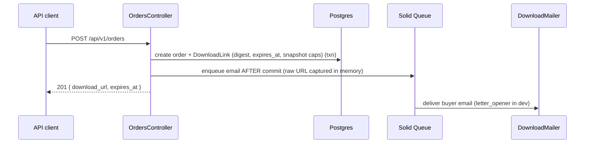
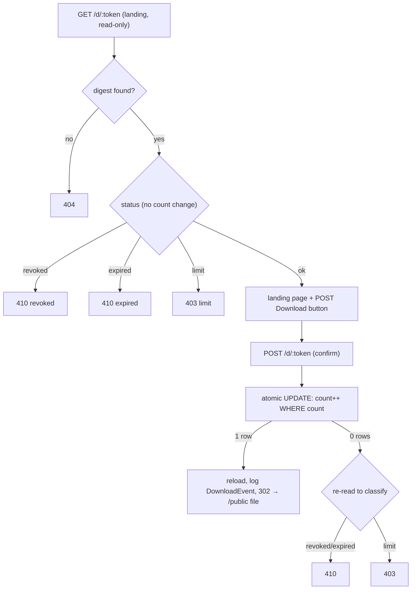

# Download System

Rails app that issues time-limited download links when a buyer purchases a digital product.

## What the app does

A merchant defines products with expiry and download limits. A JSON API accepts orders, creates a unique expiring link, and emails it to the buyer. The buyer opens the link, confirms download, and receives the file. A Svelte dashboard shows products, orders, and download activity.

**Stack:** Ruby 3.4.9, Rails 8.1, PostgreSQL, Solid Queue, Svelte 5 + TypeScript (dashboard only).

## Quick start

Requires Ruby 3.4.9 (`.ruby-version`), PostgreSQL, and Bundler. Node 20 (`.node-version`) is only needed to build the dashboard.

```bash
bundle install && bin/rails db:prepare
bin/dev
```

Open [http://localhost:3000](http://localhost:3000). Health check: [http://localhost:3000/up](http://localhost:3000/up).

Or use `bin/setup` (add `--reset` to drop and reseed; `--skip-server` to stop before starting the server).

## Assignment coverage

| Area | What works |
| ---- | ---------- |
| **Products** | `POST /api/v1/products` creates products with name, file stub, `expiry_hours`, and `max_downloads`. Seeds provide demo products. |
| **Orders & links** | `POST /api/v1/orders` creates an order, issues a unique expiring link, returns `download_url`, and queues buyer email. |
| **Downloads** | `GET /d/:token` shows a landing page; `POST /d/:token` delivers the file until expiry, cap, or revoke — each state returns the correct HTTP error. |
| **Dashboard** | Svelte/TypeScript dashboard at `/` lists products, recent orders, and download events. |

## Demo data and sample flows

Seeds create four download links covering every error state. Paste each URL into a browser (headings shown are the HTML `h1`; JSON clients get the messages in [Error → HTTP status](#error--http-status)):

| State   | URL                                              | Expected |
| ------- | ------------------------------------------------ | -------- |
| Normal  | `http://localhost:3000/d/dev-active-link-token`  | 200, landing page + `Download` button |
| Expired | `http://localhost:3000/d/dev-expired-link-token` | 410, "Download link expired" |
| Maxed   | `http://localhost:3000/d/dev-maxed-link-token`   | 403, "Download limit reached" |
| Revoked | `http://localhost:3000/d/dev-revoked-link-token` | 410, "Download link revoked" |

Clicking `Download` on the normal link redirects to `public/downloads/sample.pdf`. The database stores only `SHA256(token)`; raw tokens exist in `db/seeds.rb` and issued URLs.

Create a new order via the API:

```bash
curl -i -X POST http://localhost:3000/api/v1/orders \
  -H "Content-Type: application/json" \
  -d '{"order": {"product_id": 1, "buyer_email": "buyer@example.com"}}'
```

`201 Created` returns `order_id`, `download_url`, `expires_at`, and `max_downloads`. The same URL is emailed to the buyer (Letter Opener opens it in the browser during development). Missing product → `404`; invalid email → `422`. Errors use `{ "error": { "code", "message" } }`.

## Architecture

### Order → link → email



### Two-step download (prefetch-safe)

`GET /d/:token` is read-only — email scanners and prefetchers cannot consume a download. Only `POST /d/:token` increments the count. HTML forms include CSRF; JSON POSTs skip verification for programmatic clients.



Download-limit enforcement is a single atomic conditional `UPDATE` (no read-then-write), so the cap cannot be exceeded under concurrency. The raw 256-bit token lives only in the emailed URL; the database stores `SHA256(token)` and looks up by indexed digest.

### Error → HTTP status

| Condition                      | Status | Message                                  |
| ------------------------------ | ------ | ---------------------------------------- |
| Unknown token                  | 404    | Link not found                           |
| Expired                        | 410    | This download link has expired           |
| Revoked                        | 410    | This download link has been revoked      |
| Limit reached                  | 403    | This link has reached its download limit |
| Product missing (order create) | 404    | —                                        |
| Validation (e.g. bad email)    | 422    | —                                        |

Browsers get friendly HTML pages; API clients get JSON via `respond_to`.

## Tests and verification

```bash
bin/rails test
bin/rails test:system
```

Dashboard frontend (optional, needs Node 20):

```bash
npm ci && npm run build && npm run check
```

CI runs Brakeman, Bundler Audit, RuboCop, JavaScript audit/build, and the full test suite on push/PR to `main`.

**Concurrency test.** `test/controllers/downloads_concurrency_test.rb` fires 10 parallel `POST /d/:token` requests against a link with `max_downloads: 5`. It disables transactional fixtures and raises the connection pool to at least 15. If you see pool timeouts running that file alone, set `RAILS_MAX_THREADS=15` (or higher) before `bin/rails test`.

**Manual smoke checks** (against a running `bin/dev` server):

- `GET /up` → 200
- Seed error matrix: expired/maxed/revoked/bogus tokens → 410/403/410/404
- `POST /api/v1/orders` → 201 with `download_url`; missing product → 404; invalid email → 422
- Active link: `GET` → 200 landing; `POST` → 302 to `/downloads/sample.pdf`
- `download_links:revoke` prints idempotent message on already-revoked link

Step-by-step checklist: [docs/MANUAL_QA.md](docs/MANUAL_QA.md).

## Design decisions and tradeoffs

**Assumptions**

- **Bearer URL = access.** Anyone with `/d/:token` can download until expiry, cap, or revoke. No per-buyer auth.
- **Settings snapshotted** onto each `DownloadLink` at order time. Changing a product later does not alter issued links.
- **Placeholder delivery.** Downloads redirect to static `public/downloads/sample.pdf`, not per-product bytes.
- **Configured host.** `download_url` is built from `action_mailer.default_url_options`, not the request `Host` header.
- **Seeds reset rows, not usage.** Re-running `db:seed` does not reset `download_count` on a maxed demo link; use `bin/rails db:prepare` or reset the link manually.

**Intentional tradeoffs**

| Area | Choice | Cost |
| ---- | ------ | ---- |
| Download enforcement | Single conditional `UPDATE` | Atomic guard in one statement; `update_all` bypasses AR callbacks |
| Prefetch safety | GET landing read-only; POST confirms | Extra click; mitigates GET-only scanners, not POST bots |
| Audit trail | `DownloadEvent` after increment | Count can exceed event rows if audit insert fails |
| Email | `deliver_later` after commit | Order can exist without delivered mail if queue dies |
| API surface | Open `POST /api/v1/orders`, no idempotency | Retries create duplicate orders/links |
| Revocation | `revoked_at` timestamp only | In-flight POST may win before revoke is visible (TOCTOU) |
| Token pages | `download` layout, no JavaScript | Dashboard needs separate Vite build |
| Dashboard feeds | Orders/events capped at 50/100 rows | All products listed; pagination deferred |

Design rationale: [PROMPTS.md](PROMPTS.md).

## Operational tasks

**Revoke a link** (blocks `/d/:token` GET and POST; does not remove `public/downloads/sample.pdf`):

```bash
bin/rails 'download_links:revoke[42]'                    # by database ID
bin/rails 'download_links:revoke[dev-active-link-token]'  # by raw token (quote for zsh)
```

Re-running revoke on an already-revoked link prints "already revoked" without changing `revoked_at`.

**Background jobs.** Production uses Solid Queue for email. Development defaults to in-process `:async`. To run Solid Queue locally: `bin/jobs`.

**Email in development.** Outgoing mail opens in the browser via [Letter Opener](https://github.com/ryanb/letter_opener).

## Known limitations and production notes

**Gaps in this take-home**

- Bearer-token model — link sharing is possible; two-step flow only stops prefetchers.
- No product-create UI — products via API, seeds, or console; dashboard is read-only.
- Open order API — no auth or rate limiting; retries create duplicate orders (no idempotency key).
- Email delivery gap — order commits before `deliver_later`; queue failure means no email.
- Revoke TOCTOU — in-flight POST may succeed before `revoked_at` is visible.
- Public placeholder bytes — revocation blocks the token route, not direct `/downloads/sample.pdf` access.
- Count vs. event drift — `download_count` is canonical; failed `DownloadEvent` insert does not roll back delivery.
- Token in logs — raw tokens appear in `/d/:token` request paths.
- Dashboard pagination — 50 recent orders, 100 recent events; all products uncapped.

**What would change for production**

- Presigned S3/GCS URLs instead of static public files; never proxy bytes through Rails.
- SES/SMTP with outbox or dead-letter queue for email recovery.
- `Rack::Attack` on order creation; `Idempotency-Key` deduplication.
- `DASHBOARD_TOKEN` for dashboard API auth (set in production; unset in dev/test).
- Log scrubbing for raw tokens; host set in `config/environments/production.rb`.
- Kamal/Docker files are Rails 8 defaults — not configured for this submission.

## Project structure

```
app/
  controllers/   # API (orders, downloads) and dashboard
  models/        # Product, Order, DownloadLink, DownloadEvent
  jobs/          # Email delivery
  mailers/       # Buyer download link emails
  frontend/      # Svelte/TypeScript dashboard (Vite)
```
